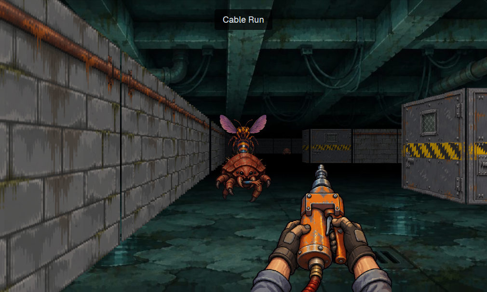

# Crawlspace

A first-person bug hunt to play while your agents work. You're the night tech under a server room, clearing mites, spitters and fuse wasps out of the crawlspace with a rivet gun, three levels down to the Brood Queen.

A mod for the [Herdr](https://github.com/ogulcancelik/herdr) desktop app. It runs on the mod API alone, with no helper program. It was run in a real Herdr 0.1.13 window on Windows, at zooms 1.0 and 1.2. It hasn't been run on macOS or Linux.

Ask your agent to add it from [herdr.dev/mods](https://herdr.dev/gallery/?type=mods), or point it at this repo. It reads [the recipe](RECIPE.md) and every file first. By hand, copy `mods/crawlspace` into `~/.config/herdr-app/mods` and merge `keys.json` into yours. `ctrl-shift-i` opens the game.

## Your agents are in the game

- **A finished turn drops supplies.** A crate lands near you with health, rivets and battery.
- **A blocked agent shows a banner.** Press `G` to go straight to it. The game closes and keeps your place, and `ctrl-shift-i` brings you back to the same spot.
- **The game pauses** when it loses the keyboard, so nothing bites you while you're in a terminal. While paused it draws twice a second.

## Keys

| Key | Does |
| --- | --- |
| `W` `S` or up and down | Walk |
| `A` `D` | Step sideways |
| Left and right, or the mouse | Turn |
| `Space` or click | Fire |
| `E` | Open a door or the hatch |
| `1` `2` | Rivet gun, Zapper |
| `G` | Go to the agent that needs you |
| `M` | Sound on or off |
| `Enter` | Start, continue, try again |
| `Esc` | Close the game |

Cards open the red and blue doors. The hatch at the end of each level takes you down. Dying restarts the level with what you brought into it.

## What it touches

It reads agent status, never terminal text. Progress is in Herdr's shared state on this machine. It runs no programs, makes no network calls and reads no files outside its own folder.

## Art

The walls, creatures, guns, items and title painting were generated with Higgsfield (GPT Image 2.6) for this game, then cut out and sized by `art/build.py`. The sounds are synthesised with `ffmpeg`. The raw images aren't in this repo.

The preview is a real frame, with the bugs placed in a line for the picture.

## Building

`node --test` runs the tests, with nothing but Node.

MIT, see `LICENSE`.
