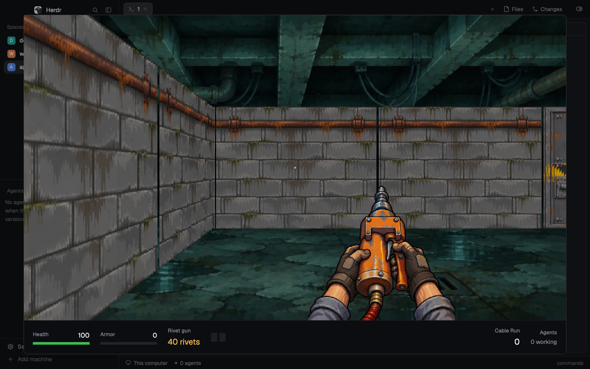

# Crawlspace

A first-person shooter in a dialog over the window, to play while agents work. You walk grid-based corridors under a server room and shoot bugs across three levels, ending at a boss. Walls are textured, and bugs are painted sprites that hide behind nearer walls. A finished agent turn drops supplies, and a blocked agent shows a banner with a key to go to it.

## What you see

**The dialog** fills 92% of the window each way. Top to bottom:

- **The view**, everything above the HUD. A painted ceiling and floor at the back, scaled to cover, then 240 wall columns (fewer below 720 wide, one per 3 units, at least 80), sprites, the gun, and a 4px dot at the centre in `#ffffff90`.
- **The gun**, at 66% across and against the bottom of the view, 44% of its height at most 340, 600 by 420 in shape. It bobs 9 units sideways while walking and kicks down 12 while firing.
- **The HUD**, 76 tall on `#0b0d10` with a `#ffffff14` top border: Health in `#3fb950` (`#f85149` at 30 or under), Armor in `#58a6ff`, the gun's name and ammo in 18px `#f2b950`, two cards as 14 by 20 tiles (`#e5534b`, `#539bf5`, unlit `#ffffff12`), then at the right the level's name and score, and how many agents are working.

**Banners**, on `#000000b0`, radius 4, 15px: notes at the top (the level's name, what you picked up, why a door won't open), and at 56 down, in `#ff7b72`, `An agent needs you. G to go.`

**Hit:** a `#c0201030` wash, plus a `#e0302080` edge 10% wide on the side the hit came from, for 0.35 s.

**Screens:** the title painting under `#00000070`, with words in `#f2b950` at 56px on the title and 38px elsewhere. Title (`CRAWLSPACE`), dead, level clear, won. **Paused:** `#00000090` over the view, `Paused`, `Click to play`.

## How it behaves

- **Agents:** read once a second from `agents()`.
- **working:** counted in the HUD. No other effect.
- **blocked:** the banner shows while any agent is blocked. `G` closes the dialog and runs `agent.focus` on the first one.
- **done or idle after working or blocked:** a finished turn. A crate lands 1.5 ahead and to the right, or at your feet if that's a wall. It gives 15 health, 15 rivets, 6 battery. Only while a level is in play.
- **Keys:** `W` `S`, up and down walk at 3.1 tiles a second. `A` `D` step sideways. Left and right turn at 2.5 radians a second, and the mouse turns too. `Space` or a held click fires, `E` opens what's 0.9 ahead, `1` `2` pick a gun, `M` toggles sound, `Enter` moves past a screen, `N` on the title starts over.
- **Focus:** losing the keyboard pauses and lets go of every held key. In a dialog the mod focuses itself. A click takes the keyboard back.
- **Keeping your place:** closing saves the whole level to `crawlspace.live`, and the next open carries on there, paused until focused. A dead or finished run isn't kept. Starting a level saves `crawlspace.save` for Continue, and clearing one moves that on to the next level, so closing on the clear screen loses nothing. The save holds the agents as last seen, so a turn that ends while the game is closed still drops a crate.
- **Dying** restarts the level with what you carried into it.
- **Bugs:**

| Tile | Bug | Health | Speed | Bite or spit | Wait | Points |
| --- | --- | --- | --- | --- | --- | --- |
| `m` | Mite | 22 | 2.1 | 6 at 1.15 | 1.1 s | 10 |
| `s` | Spitter | 65 | 1.05 | 12 at 8, a slow glob | 2 s | 40 |
| `w` | Fuse wasp, flies | 32 | 2.9 | 9 at 1.2 | 1.1 s | 25 |
| `Q` | Brood Queen | 900 | 0.55 | Three globs of 16 at 11, sometimes hatches a mite | 1.5 s | 500 |

Bugs wake when they see you within 9 tiles, or when shot. Biters stop 0.9 away so they stay in view; spitters keep 3 away.

- **Guns:** Rivet gun, 1 rivet, 19 damage, every 0.3 s, the first bug in line. Zapper, 2 cells, 42 damage, every 0.6 s, up to 3 bugs in a cone of 0.16 radians either side.
- **Armor** takes half of each hit until it runs out.
- **Doors** slide sideways at 1.8 a second and stay open. `r` needs the red card, `b` the blue, and cards don't carry between levels. The last hatch won't open while the queen lives.

## Built from

- **One mod,** `mods/crawlspace`, with `{ "place": "none", "title": "Crawlspace", "focusable": true, "overlay": { "width": 0.92, "height": 0.92 } }`, opened by `mod.open`. It also works as a pane: `tab.new {mod: "crawlspace"}`.
- **Files:** `engine.js` the ray caster and projection, `game.js` the rules, `levels.js` the maps as text, `view.js` the drawing, `main.js` the loop, keys and saving. The first three make no app calls, so tests run them in Node.
- **`herdr`:** `agents`, `nextCommand`, `playSound`, `props`, `run` (`agent.focus`), `setShared`, `shared`, `settings().zoom`, `closeOverlay`.
- **Drawing:** one element per wall column: a `div` with `overflow_hidden`, holding the texture as an `image()` scaled to the column's height and shifted left to the right slice, with a shade `div` over it. Sprites are `image()`s. Columns and sprites are sorted by depth and painted far to near, so hiding a sprite behind a wall costs nothing.
- **Loop:** `cx.timer.every(16)`, about 32 frames a second in practice. Draw time was 7 ms on average and 19 ms at worst at 240 columns.
- **Art:** `mods/crawlspace/art`, 256px walls and sprites, 128px items and effects, 600 by 420 guns. **Sound:** seven short MP3s through `playSound`.

## Watch out

- **Colours must be literal.** `rgba()` throws. Use `#rrggbbaa`.
- **`image()` keeps its shape.** A picture stretched to a box of another shape gets bars, so size it to cover.
- **Tab did nothing in the dialog** on Herdr 0.1.13, which is why the key is `G`.
- **Sizes:** `on_size_change` reports window pixels, and `.w()` is in the app's own units. Divide by `settings().zoom`.
- **A saved mod file restarts the mod.** State in the view is lost on a hot reload.
- **`is_focused()` is the pause.** Clear held keys on losing focus, or a key let go elsewhere can stay down.
- **The floor and ceiling don't move** when you turn. They're one picture, because per-pixel floors aren't possible with elements.
- **Each open copy is its own game.** A pane and a dialog open together each get a crate for the same turn.
- **The mouse can't be captured.** Turning stops at the edge of the window.

## Done when

- `herdr-app check` passes and `ctrl-shift-i` opens the game on the title.
- `Enter` starts a level, `W` walks, `E` opens the first door, and a shot kills a mite and adds 10 to the score.
- A bug beside you shows a red edge on that side.
- A stand-in agent going blocked shows the banner, `G` lands on its tab with the dialog closed, and `ctrl-shift-i` returns to the same spot.
- The same agent going idle drops a crate.
- At zoom 1.2 the HUD sits at the bottom with nothing cut off.
- `node --test` passes, including every level's hatch being reachable with the cards you can find.
